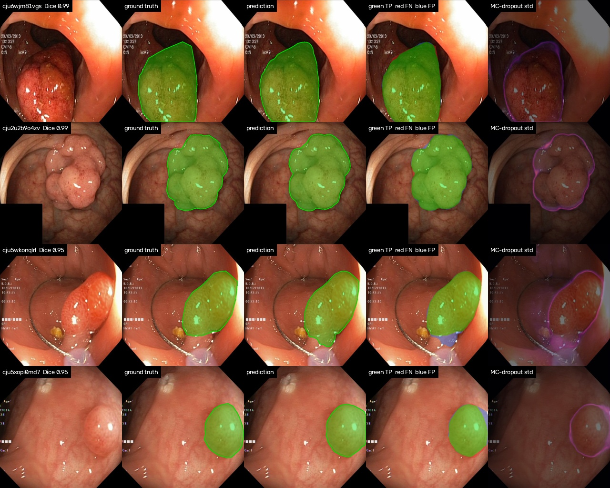
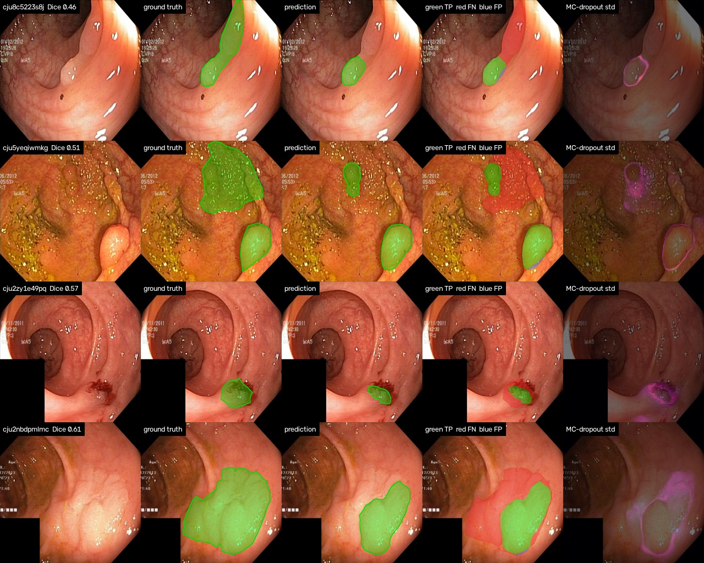
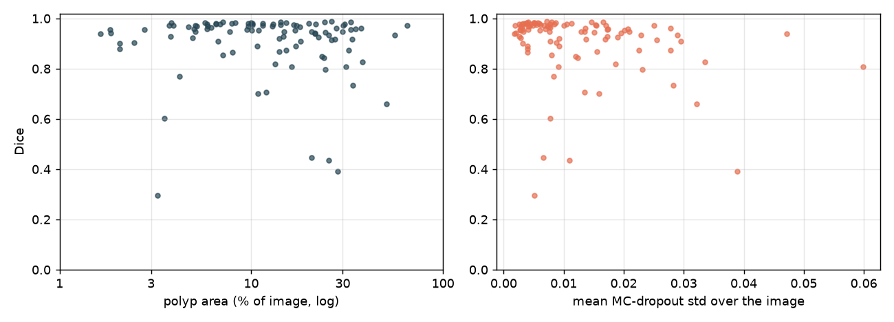
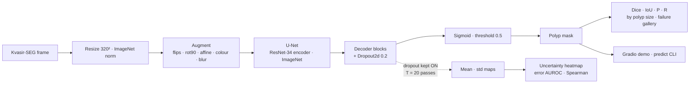

<div align="center">

# 🔬 Polyp Segmentation with a U-Net — and knowing when it's unsure

**Colon polyp segmentation on Kvasir-SEG with a pretrained-encoder U-Net (BCE + Dice), honest evaluation (Dice / IoU, size-stratified, failure-case gallery) and Monte-Carlo-dropout uncertainty maps that are tested against the model's own errors.**

[](https://github.com/haroonkhan02/polyp-segmentation-unet/actions/workflows/ci.yml)




<sub>Test images (best and median cases): input · ground truth · prediction · error map (green TP, red FN, blue FP) · MC-dropout uncertainty.</sub>

</div>

> ⚠️ **Not for clinical use.** This is a research / portfolio project trained on 800 images from a single hospital. It has not been validated on other scanners, populations or workflows, and it is not a medical device. See the [model card](MODEL_CARD.md).

---

## Highlights

- **Complete, reproducible pipeline** — one command each to download Kvasir-SEG, train, evaluate, predict and launch a demo. A seeded 80/10/10 split is committed, so the test set is fixed and touched once.
- **U-Net with a pretrained ResNet-34 encoder**, trained with BCE + soft Dice on an Apple M5 GPU (MPS) in 40 minutes.
- **Uncertainty you can check** — `Dropout2d` after every decoder block stays on at test time (MC dropout). The std map is evaluated as an *error detector*: pixel-level AUROC 0.930, and the model's uncertainty is 10.0× higher on the pixels it gets wrong.
- **Error analysis, not just a mean** — per-image Dice histogram, Dice stratified by polyp size, a worst-cases gallery and Dice-vs-uncertainty scatter, all generated by `polyp-evaluate`.
- **Tested without data** — 27 unit tests on synthetic images (augmentation alignment, loss limits, metric identities, MC-dropout stochasticity, checkpoint round-trip) run in CI on Python 3.10–3.12.

## Results

Held-out **test split: 100 Kvasir-SEG images** (seed-0 split in [`configs/split.json`](configs/split.json)), threshold 0.5, original resolution. Checkpoint = best validation Dice (epoch 35 of 40). Inference time is for a 320×320 forward pass on an Apple M5 (MPS), excluding I/O.

| Prediction | mean Dice ↑ | mean IoU ↑ | Precision | Recall | Dataset-level Dice | ms / image |
|---|---|---|---|---|---|---|
| Deterministic (dropout off) | **0.904** | **0.844** | 0.937 | 0.901 | 0.903 | 6.4 |
| MC-dropout mean (20 passes) | 0.904 | 0.845 | 0.937 | 0.903 | 0.904 | 188 |

*Mean Dice/IoU average the per-image scores (the convention in Kvasir-SEG papers); dataset-level Dice pools all pixels and is dominated by large polyps.*

**By polyp size** (fraction of the frame covered by the ground-truth mask):

| Polyp size | Images | mean Dice | mean IoU | Recall |
|---|---|---|---|---|
| small (<5%) | 16 | 0.868 | 0.798 | 0.908 |
| medium (5-20%) | 51 | 0.938 | 0.890 | 0.937 |
| large (>20%) | 33 | 0.867 | 0.794 | 0.843 |

**Is the uncertainty useful?** (MC dropout, 20 stochastic passes)

| Check | Value | Meaning |
|---|---|---|
| Mean std on mis-classified pixels | 0.103 | vs. 0.010 on correct pixels → 10.0× higher where the model is wrong |
| Pixel-error AUROC of the std map | 0.930 | 0.5 = noise, 1.0 = perfect error detector |
| Spearman(image Dice, mean std) | -0.36 | negative = the model is more uncertain on the frames it segments badly |

<p align="center"></p>
<p align="center"><sub>The four worst test cases. All four are under-segmentation: precision stays above 0.9 while recall drops to 0.17–0.29. The model outlines only the core of a bleeding lesion (row 1), misses the large polyp on the right while finding the two smaller ones (row 2), finds only the centre of a large flat lesion (row 3) and finds the raised polyp but not the flat one above it (row 4). Row 2 is the one case where the uncertainty map lights up the missed region; rows 1, 3 and 4 are confident misses.</sub></p>

<p align="center"></p>

**What the numbers say**

- **A plain U-Net with a pretrained encoder gets to 0.90 mean Dice on Kvasir-SEG in 40 minutes on a laptop GPU.** 75 of 100 test images score above 0.9 and the median is 0.95, so the mean is pulled down by a handful of hard cases (4 below 0.5) rather than by general sloppiness.
- **Errors are misses, not false alarms.** Precision (0.94) is higher than recall (0.90) and every one of the worst cases is under-segmentation of a flat or multi-part polyp. Small (< 5 %) and large (> 20 %) polyps are equally hard (Dice 0.868 / 0.867) and medium ones easiest (0.938): small polyps have few pixels to get right, and when a polyp fills the frame its boundary is a subtle texture change rather than a clear edge.
- **The uncertainty map is a good boundary-error detector and a poor miss detector.** Per pixel, std is 10× higher where the model is wrong (AUROC 0.93), so a UI could draw a reliable "fuzzy edge" band. Per image, the correlation with Dice is only moderate (Spearman −0.36): the worst case ranks 29th of 100 by uncertainty, i.e. *less* uncertain than most frames, because MC dropout only captures disagreement between dropout samples and all of them agreed the missed tissue was mucosa. Catching those would need test-time augmentation, an ensemble or out-of-distribution signals.
- **Averaging 20 MC passes does not improve Dice** (0.904 vs 0.904) at 29× the inference cost; its value here is the uncertainty, not the mask.
- **No overfitting at this budget**: validation loss stays at ≈0.11–0.12 from epoch 25 while train loss keeps falling to 0.09, and validation Dice plateaus at ≈0.89–0.90 from epoch 27, so the gains left are in data (more centres, negatives) and architecture, not in longer training.

> **Retrained 2026-10-10 after a bug fix.** The first run (v1) had a data-loader bug: the 4 worker processes shared one random-number generator state, so they drew identical augmentation parameters. With per-worker seeding (`polypseg.data.seed_worker`) the same config gives mean Dice 0.904 vs. 0.908 before, IoU 0.844 vs. 0.848, uncertainty AUROC 0.930 vs. 0.906 and 4 vs. 1 test images below Dice 0.5. Every difference is within the sampling noise of a 100-image test set (the 95 % interval on mean Dice is about ±0.025), so the fix made training correct rather than measurably better. The numbers above are from the fixed run.

> **Caveats.** 100 test images give roughly ±0.025 of noise on the mean Dice (95 % interval); the split is my own (there is no official one), so numbers are not strictly comparable to papers; and every Kvasir-SEG frame contains a polyp, so the false-positive rate on healthy mucosa is *unknown*.

Training curves: [`reports/training_curves.png`](reports/training_curves.png) · history: [`reports/training_history.json`](reports/training_history.json) · raw metrics (per image): [`reports/results_test.json`](reports/results_test.json).

## How it works



**Training.** Loss = ½ BCE + ½ soft Dice: BCE gives stable per-pixel gradients, Dice optimises the overlap we report and ignores the ~90 % background pixels. AdamW with a OneCycle schedule, batch 8, 40 epochs; the checkpoint with the best *validation mean Dice* is kept.

**Uncertainty.** With dropout active at test time, each forward pass samples a slightly different network (Gal & Ghahramani, 2016). Twenty passes are run as one batch; their mean is a cheap ensemble prediction and their per-pixel std is the epistemic uncertainty. `Dropout2d` drops whole channels so the sampled segmentations differ coherently rather than as pixel noise. BatchNorm stays in eval mode throughout.

## Repository structure

```text
polyp-segmentation-unet/
├── src/polypseg/
│   ├── download.py      # Kvasir-SEG download + extraction + verification
│   ├── data.py          # Listing, seeded 80/10/10 split, JPEG-mask thresholding, Dataset
│   ├── augment.py       # Paired image/mask augmentation (OpenCV)
│   ├── model.py         # U-Net + Dropout2d decoder, checkpoints, PolypSegmenter (det. + MC)
│   ├── losses.py        # Soft Dice, BCE + Dice
│   ├── metrics.py       # Dice / IoU / precision / recall, per-image and pooled
│   ├── uncertainty.py   # MC-dropout mean/std, entropy, error-vs-uncertainty AUROC
│   ├── train.py         # Training loop (MPS / CUDA / CPU), best-on-val checkpoint
│   ├── evaluate.py      # Metrics, size strata, galleries, plots -> reports/
│   ├── predict.py       # CLI: overlays + uncertainty maps for an image or folder
│   ├── demo.py          # Gradio app
│   ├── plots.py         # Training curves, Dice histogram, error analysis
│   ├── viz.py           # Overlays, heatmaps, mosaics
│   └── config.py        # Paths + YAML-backed TrainConfig
├── configs/             # kvasir_unet.yaml (hyper-parameters), split.json (fixed split)
├── tests/               # 27 unit tests on synthetic images (no data / GPU)
├── reports/             # Results JSON, galleries, curves (generated by the CLIs)
├── MODEL_CARD.md        # Intended use, data, metrics, limitations
├── data/  models/       # Dataset & weights (git-ignored)
└── .github/workflows/   # CI: ruff + pytest on Python 3.10–3.12
```

## Getting started

```bash
git clone https://github.com/haroonkhan02/polyp-segmentation-unet.git
cd polyp-segmentation-unet
uv venv --python 3.12 && source .venv/bin/activate
uv pip install -e ".[demo,dev]"

polyp-download                                   # Kvasir-SEG, 46 MB -> data/Kvasir-SEG/
polyp-train --config configs/kvasir_unet.yaml    # ~40 min on an Apple M5 (MPS)
polyp-evaluate --split test --mc-samples 20      # writes reports/
polyp-predict data/Kvasir-SEG/images/cju0qkwl35piu0993l0dewei2.jpg --mc-samples 20
polyp-demo                                       # http://127.0.0.1:7860
```

Trained weights are not committed (98 MB); `polyp-train` reproduces them in one run. Any config key can be overridden on the command line, e.g. `polyp-train --encoder resnet18 --epochs 20`.

## Design decisions

| Decision | Why |
|---|---|
| Committed seed-0 split instead of an ad-hoc one | Kvasir-SEG has no official split; a fixed file makes every number reproducible and the test set untouchable. |
| Threshold JPEG masks at 127 | Kvasir masks are JPEGs; compression leaves values 1–254 at edges that would become soft, wrong targets. |
| BCE + Dice, not BCE alone | Polyps are often < 10 % of the frame; BCE alone rewards "all background". |
| `Dropout2d` after each decoder block | Channel dropout yields coherent alternative segmentations for MC sampling; per-pixel dropout barely changes a conv feature map. |
| Checkpoint chosen on validation Dice | Select on the metric you report, not on loss. |
| Uncertainty evaluated against errors | An uncertainty map is only useful if it is higher where the model is wrong; AUROC and Spearman make that checkable. |
| Vertical flips and 90° rotations allowed | Endoscopic frames have no canonical orientation (unlike road scenes). |
| Report both per-image and pooled Dice | Papers use the former; the latter hides failures on small polyps. |

## Testing

```bash
pytest     # synthetic polyps — no dataset, GPU or download needed
ruff check .
```

## Future work

- Cross-dataset evaluation on CVC-ClinicDB / ETIS-Larib to measure the domain gap
- Add polyp-free frames (e.g. from Kvasir / HyperKvasir) so false positives on healthy mucosa can be measured
- Compare MC dropout with a 5-model deep ensemble and test-time augmentation
- Stronger decoders (U-Net++, FPN) and a transformer encoder (MiT / Swin) at the same budget
- Deploy the Gradio demo to Hugging Face Spaces

## Acknowledgements

[Kvasir-SEG](https://datasets.simula.no/kvasir-seg/) — Jha et al., *Kvasir-SEG: A Segmented Polyp Dataset*, MMM 2020 (CC BY 4.0) · [segmentation_models.pytorch](https://github.com/qubvel-org/segmentation_models.pytorch) · Gal & Ghahramani, *Dropout as a Bayesian Approximation*, ICML 2016

## License

[MIT](LICENSE) © Muhammad Haroon Khan
