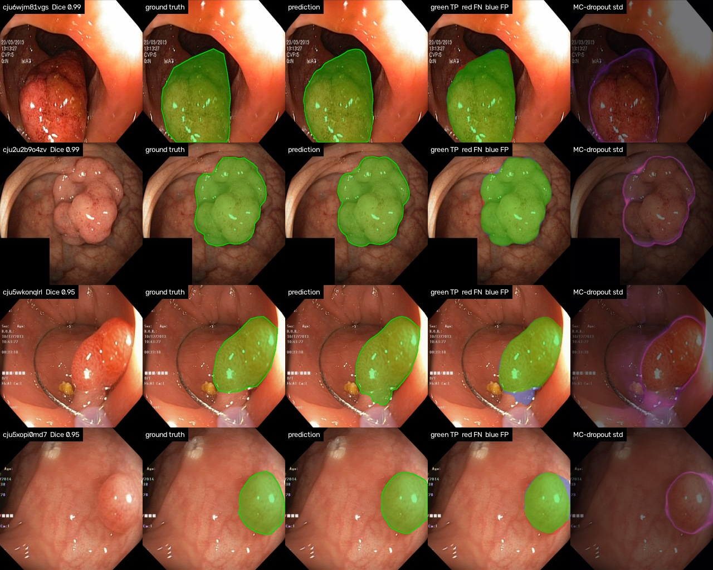
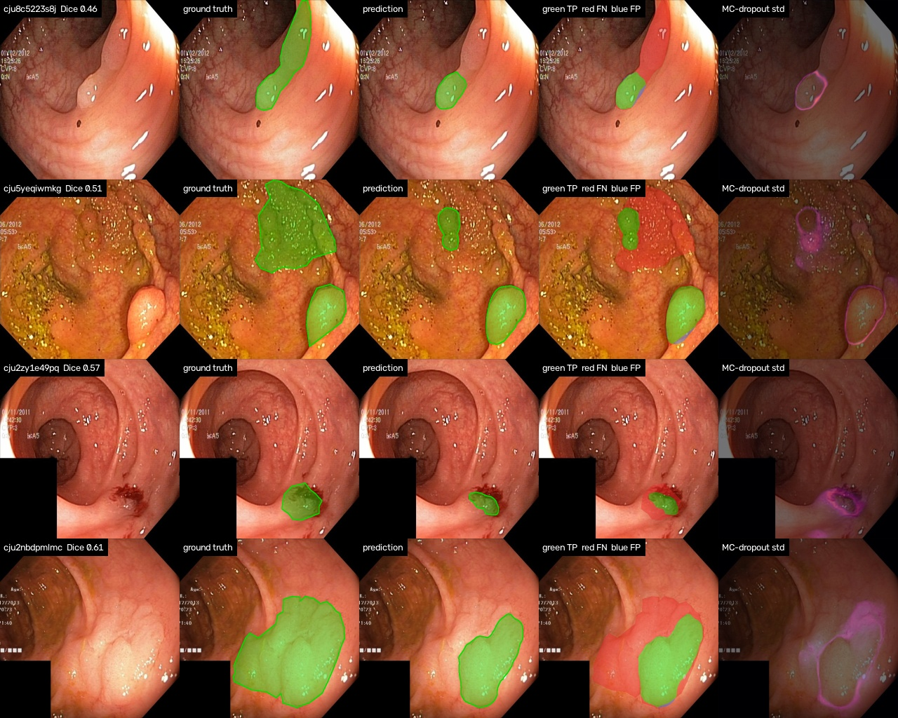
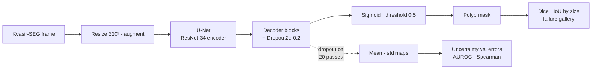

<div align="center">

# Polyp Segmentation with a U-Net

Colon polyp segmentation on Kvasir-SEG with a pretrained-encoder U-Net, plus Monte Carlo dropout uncertainty maps that are checked against the model's own errors.

[](https://github.com/haroonkhan02/polyp-segmentation-unet/actions/workflows/ci.yml)




<sub>Test images: input, ground truth, prediction, error map (green TP, red FN, blue FP), MC-dropout uncertainty.</sub>

</div>

> **Not for clinical use.** Trained on 800 images from a single hospital and not validated on other scanners or populations. See the [model card](MODEL_CARD.md).

## What it does

- Downloads Kvasir-SEG (1,000 endoscopy frames with masks) and splits it 80/10/10 with a committed, seeded split.
- Trains a U-Net with an ImageNet ResNet-34 encoder on BCE + soft Dice, in about 40 minutes on an Apple M5 GPU.
- Keeps dropout on at test time to produce a per-pixel uncertainty map, then measures whether that map is actually high where the model is wrong.
- Reports Dice and IoU per image, by polyp size, and with a gallery of the worst cases. A CLI and a Gradio demo run the model on new images.

## Results

Held-out test split of 100 images, threshold 0.5, checkpoint with the best validation Dice (epoch 35 of 40). Time is a 320×320 forward pass on an M5 (MPS).

| Prediction | Mean Dice | Mean IoU | Precision | Recall | ms / image |
|---|---|---|---|---|---|
| Deterministic | 0.904 | 0.844 | 0.937 | 0.901 | 6.4 |
| MC-dropout mean (20 passes) | 0.904 | 0.845 | 0.937 | 0.903 | 188 |

| Polyp size (share of frame) | Images | Mean Dice | Recall |
|---|---|---|---|
| Small (< 5 %) | 16 | 0.868 | 0.908 |
| Medium (5–20 %) | 51 | 0.938 | 0.937 |
| Large (> 20 %) | 33 | 0.867 | 0.843 |

| Is the uncertainty useful? | Value |
|---|---|
| Mean std on wrong vs. correct pixels | 0.103 vs. 0.010 (10× higher) |
| Pixel-error AUROC of the std map | 0.930 |
| Spearman (image Dice, mean std) | −0.36 |

75 of 100 test images score above 0.9 and the median is 0.95; the mean is pulled down by four hard cases below 0.5. Errors are misses rather than false alarms: precision is higher than recall, and all of the worst cases are flat or multi-part polyps that are only partly segmented. The uncertainty map is a good boundary-error detector but a poor miss detector. Per pixel it separates errors well, but the worst image ranks only 29th of 100 by uncertainty, because all dropout samples agree the missed tissue is normal mucosa. Averaging 20 passes doesn't improve the mask; its value is the uncertainty.

Limitations of the evaluation: 100 test images give about ±0.025 noise on mean Dice (95 % interval), the split is my own so numbers aren't strictly comparable to papers, and every Kvasir-SEG frame contains a polyp, so the false-positive rate on healthy mucosa is unknown.

<p align="center"></p>
<p align="center"><sub>The four worst test cases, all under-segmentation (precision above 0.9, recall 0.17–0.29). Only row 2 has high uncertainty over the missed region; the others are confident misses.</sub></p>

Training curves, error-analysis plots and per-image metrics are in [`reports/`](reports).

## How it works



The loss is half BCE and half soft Dice: BCE gives stable per-pixel gradients, and Dice optimises the overlap that's reported while ignoring the ~90 % background. Training uses AdamW with a OneCycle schedule, batch 8, 40 epochs.

For uncertainty, each forward pass with dropout active samples a slightly different network (Gal & Ghahramani, 2016). Twenty passes run as one batch; their mean is a cheap ensemble and their per-pixel standard deviation is the uncertainty. BatchNorm stays in eval mode.

## Getting started

```bash
git clone https://github.com/haroonkhan02/polyp-segmentation-unet.git
cd polyp-segmentation-unet
uv venv --python 3.12 && source .venv/bin/activate
uv pip install -e ".[demo,dev]"

polyp-download                                   # Kvasir-SEG, 46 MB
polyp-train --config configs/kvasir_unet.yaml    # ~40 min on an M5
polyp-evaluate --split test --mc-samples 20      # writes reports/
polyp-predict path/to/frame.jpg --mc-samples 20  # overlay + uncertainty map
polyp-demo                                       # Gradio app
```

Weights (98 MB) are not committed; `polyp-train` reproduces them. Config keys can be overridden on the command line, e.g. `polyp-train --encoder resnet18 --epochs 20`. Tests use synthetic images and need no data or GPU: `pytest` (27 tests) and `ruff check .`.

## Repository structure

```text
polyp-segmentation-unet/
├── src/polypseg/
│   ├── download.py      # Kvasir-SEG download and verification
│   ├── data.py          # seeded split, mask thresholding, Dataset
│   ├── augment.py       # paired image/mask augmentation
│   ├── model.py         # U-Net with decoder dropout, PolypSegmenter
│   ├── losses.py        # soft Dice, BCE + Dice
│   ├── metrics.py       # Dice / IoU / precision / recall
│   ├── uncertainty.py   # MC-dropout maps, error-vs-uncertainty AUROC
│   ├── train.py         # training loop (MPS / CUDA / CPU)
│   ├── evaluate.py      # metrics, size strata, galleries -> reports/
│   ├── predict.py       # CLI for an image or folder
│   ├── demo.py          # Gradio app
│   ├── plots.py  viz.py # curves, overlays, heatmaps
│   └── config.py        # paths and YAML-backed config
├── configs/             # hyper-parameters, fixed split
├── tests/               # synthetic images, no data needed
├── reports/             # results, galleries, curves
├── MODEL_CARD.md        # intended use and limitations
└── data/  models/       # dataset and weights (git-ignored)
```

## Design decisions

| Decision | Why |
|---|---|
| Committed seed-0 split | Kvasir-SEG has no official split; a fixed file keeps the test set untouched and every number reproducible. |
| Threshold JPEG masks at 127 | Compression leaves edge values 1–254 that would otherwise become soft, wrong targets. |
| BCE + Dice | Polyps are often under 10 % of the frame; BCE alone rewards predicting background. |
| `Dropout2d` after each decoder block | Dropping whole channels gives coherent alternative masks; per-pixel dropout barely changes a conv feature map. |
| Uncertainty scored against errors | An uncertainty map is only useful if it's higher where the model is wrong. |
| Vertical flips and 90° rotations | Endoscopy frames have no canonical orientation. |
| Augmentation RNG seeded per DataLoader worker | Otherwise all workers draw identical augmentations. |

## Limitations and future work

- Single-centre data. Cross-dataset tests on CVC-ClinicDB or ETIS-Larib would measure the domain gap.
- No polyp-free frames, so false positives on healthy tissue can't be measured; HyperKvasir negatives would fix that.
- MC dropout misses confident errors. A deep ensemble or test-time augmentation is the next comparison.
- Stronger decoders (U-Net++, FPN) or a transformer encoder at the same budget.

## Acknowledgements

[Kvasir-SEG](https://datasets.simula.no/kvasir-seg/) (Jha et al., MMM 2020, CC BY 4.0) · [segmentation_models.pytorch](https://github.com/qubvel-org/segmentation_models.pytorch) · Gal & Ghahramani, *Dropout as a Bayesian Approximation*, ICML 2016

## License

[MIT](LICENSE) © Muhammad Haroon Khan
